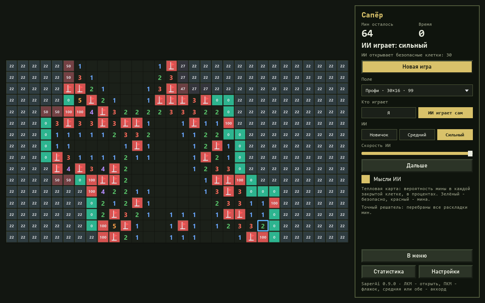
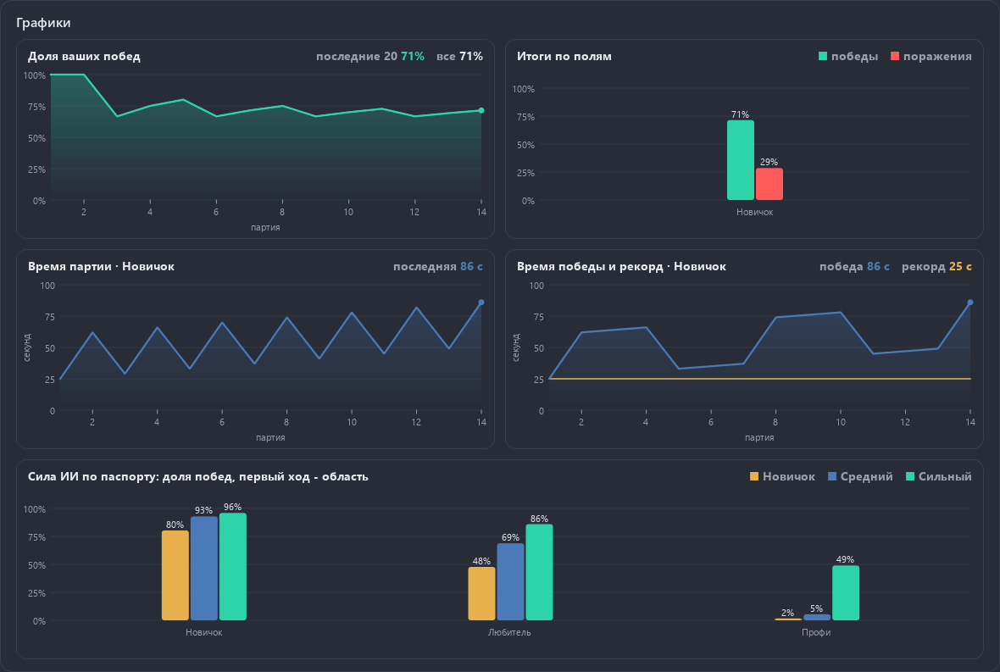

<div align="center">

# Minesweeper with an AI

**Classic Minesweeper and an AI that computes the exact chance of a mine in every closed cell. It can give a hint, show its thoughts as a heat map, or play by itself.**

[Русская версия](README.ru.md)

[](LICENSE)



</div>

## Features

- **Boards:** beginner 9×9 / 10 mines, intermediate 16×16 / 40, expert 30×16 / 99, and custom (up to 60×60).
- **The first click is always safe.** The "First click" setting: "opens an area" (default,
  no mines around the first click) or "only the cell is safe" (like old Windows).
- **No-guess boards:** the generator reshuffles mines until the exact solver clears the
  board from the first click with safe moves only.
- Flags, **chording** (both buttons or the middle one), mine counter, timer, best times per board.
- **Three AI levels:** novice (simple rules only), medium (a network), strong (the exact solver).
- **AI plays** with a speed slider and pause: it opens cells and flags certain mines.
- **Hint:** a safe cell or, if there is none, the least risky cell and its risk in percent.
- **AI thoughts:** a heat map over the board with the chance of a mine in every closed cell.
- Paint themes (dark and light), Russian and English, the window reopens where it was closed.

Games with a hint or AI thoughts do not count for statistics and records.

Statistics show charts (the shared `aikit.charts`): your share of wins (last 20 and all games), wins and explosions on each board, the time of each game and of each win with your record on the board chosen in the settings (seconds on Beginner and Expert are not comparable), and the AI strength from the passport as bars. With no games yet a chart says in words what will appear.



## How the AI thinks

The **exact solver** (`game/ai/solver.py`) sees only what the player sees: open numbers,
closed cells and the total mine count. It ignores flags, since a person may have placed one wrongly.

1. Each number is an equation: the mines among its closed neighbours add up to it.
2. Simple rules to a fixed point, then the subset rule (one equation inside another).
3. The rest of the border splits into independent groups; each group enumerates **every**
   mine layout consistent with the numbers, per mine count.
4. Groups are combined with the total mine count: a border layout with m mines weighs
   C(interior, remaining − m). Integer arithmetic gives the **exact probability**.

Very large groups hit a node budget and fall back to an approximation, and the window says so.
In the passport this happened in 86 of 60 000 strong games (0.14 %), almost all on expert.

**Move choice:** all certainly safe cells at once; otherwise the lowest risk, with ties
broken by the chance to open a zero (corners win). The first click is the centre with
"opens an area" and a corner with "only the cell is safe" (measured on expert, 2000 games each).

The **network** (`game/ai/net.py`) is a numpy CNN: 4 3×3 layers of 24 channels,
18 049 weights, the same weights for any board size. It was trained on 138 129 positions
(26 485 613 labelled closed cells) from 6 000 games, with the solver's exact probability as
the target. Mean error on held-out positions: 0.033; it picks the truly safest cell 97 % of the time.

## AI passport

Share of games won, 10,000 seeded games per board and first-click rule
(`game/models/saper-passport.json`, recompute with `python -m game.train.passport`).

| Board | First click | Novice AI | Medium AI | Strong AI |
|---|---|---:|---:|---:|
| Beginner 9×9 / 10 | opens an area | 80.4 % | 92.8 % | **96.0 %** |
| Beginner 9×9 / 10 | only the cell | 68.5 % | 84.7 % | **91.3 %** |
| Intermediate 16×16 / 40 | opens an area | 47.8 % | 68.8 % | **86.0 %** |
| Intermediate 16×16 / 40 | only the cell | 35.8 % | 57.1 % | **77.4 %** |
| Expert 30×16 / 99 | opens an area | 1.7 % | 5.4 % | **49.0 %** |
| Expert 30×16 / 99 | only the cell | 0.9 % | 4.1 % | **38.6 %** |

The spec's target for strong on expert with a safe first click is about 50 % or more.
The real number: **49.0 %** with "opens an area" and **38.6 %** with
"only the cell is safe". Expert cannot always be won: many boards contain a pure 50/50 guess.

## Tests

232 tests (pytest); the window is tested offscreen only, with synthesized mouse events.

- **Exactness law:** on small boards the solver's probabilities equal a full enumeration of all layouts.
- **Honesty law:** two different mine layouts with the same visible board lead to the same AI decision.
- Rules: hand-made boards per rule and random games with invariants.
- **Mutation testing** `tools/mutate.py`: 47 deliberate breakages, all caught.
- Passport: the first games of each check are replayed with the same seeds.

## Running and building

```
python -m pip install -r requirements-dev.txt
python main.py
python -m pytest -q
```

`python build.py` (needs pyinstaller and pillow) builds `dist/SaperAi`, a portable archive
and an NSIS installer. PySide6 and numpy only, no pygame, no PyTorch. MIT license.
