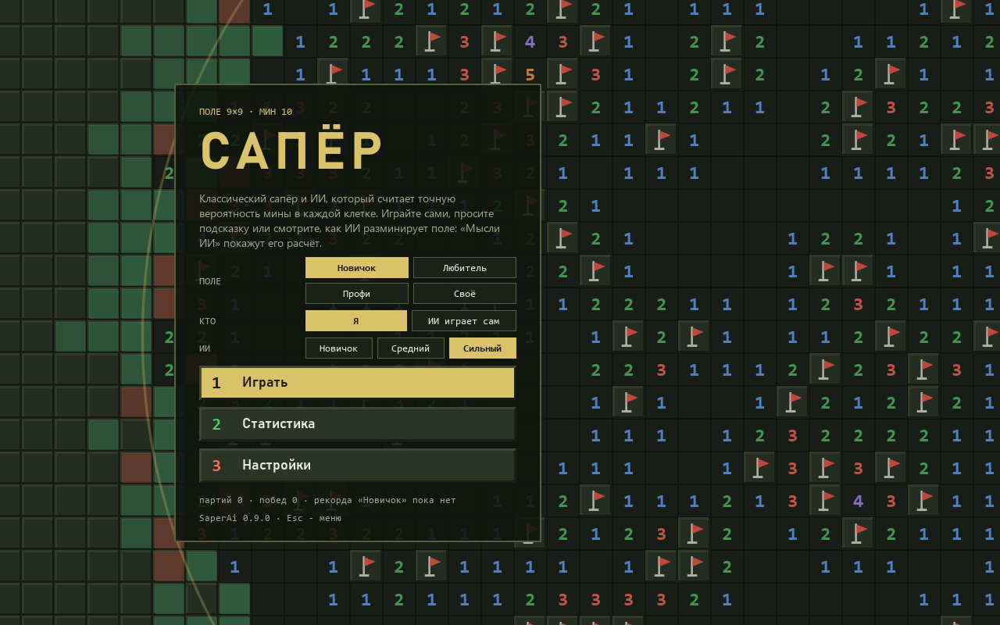
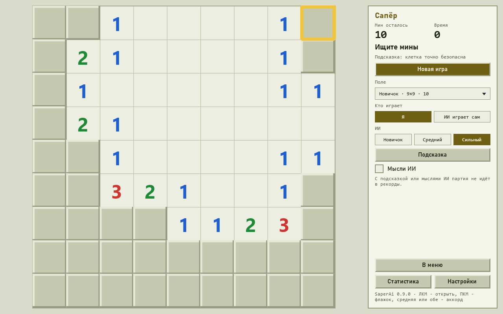

<div align="center">

# Сапёр с ИИ

**Классический сапёр и ИИ, который считает точную вероятность мины в каждой закрытой клетке. Он подскажет ход, покажет свои мысли тепловой картой или сыграет сам.**

[English version](README.md)

[](#) [](https://github.com/ALEXalesha/SaperAi/releases/latest) [](https://github.com/ALEXalesha/SaperAi/actions/workflows/ci.yml) [](LICENSE) [](https://www.python.org/) [](https://doc.qt.io/qtforpython-6/) [](https://claude.com/claude-code)

Код, тесты и документация этого проекта написаны Claude (Anthropic) в Claude Code. Идеи, проверка и решения - Алексей.


</div>

## Что умеет

- **Поля:** новичок 9×9 / 10 мин, любитель 16×16 / 40, профи 30×16 / 99 и своё (до 60×60).
- **Первый клик всегда безопасен.** Настройка «Первый клик»: «открывает область» (по
  умолчанию - вокруг первого клика нет мин) или «безопасна только клетка» (как в старом Windows).
- **Поле без угадываний:** генератор перекладывает мины, пока точный решатель не пройдёт
  поле от первого клика одними безопасными ходами.
- Флажки, **аккорд** (обе кнопки мыши или средняя), счётчик мин, таймер, рекорды по каждому полю.
- **Три уровня ИИ:** новичок (только простые правила), средний (сеть), сильный (точный решатель).
- **«ИИ играет сам»** со скоростью и паузой: ИИ открывает клетки и ставит флажки на точные мины.
- **Подсказка:** безопасная клетка, а если таких нет - клетка с наименьшим риском и сам риск в процентах.
- **«Мысли ИИ»:** тепловая карта поверх поля - вероятность мины в каждой закрытой клетке,
  числа в процентах. Видно, как думает выбранный уровень: точный решатель, сеть или новичок.
- **Стартовое меню «полевая карта»:** на фоне ИИ разминирует поле волной, перед волной -
  тепловая полоса «Мыслей ИИ»; квадратная панель с кнопками-клетками и цифрами сапёра, выбор
  поля, кто играет и уровня ИИ, «Продолжить» для начатой партии, итоги и рекорд поля. Боковая
  панель у поля и само поле - в тех же цветах. Меню растёт вместе с окном до 4K.
- **Настройки на всю ширину окна**, как статистика.
- Темы Paint (тёмная и светлая), русский и английский, окно открывается там, где его закрыли.

Партия с подсказкой или включёнными «Мыслями ИИ» в статистику и рекорды не идёт.



В статистике графики (общий `aikit.charts`): доля ваших побед (последние 20 и все партии), победы и подрывы на каждом поле, время каждой партии и каждой победы с рекордом на поле из настроек (секунды «Новичка» и «Профи» не сравнить) и сила ИИ по паспорту столбиками. Пока партий нет, на графике написано словами, что там появится.




## Как думает ИИ

**Точный решатель** (`game/ai/solver.py`) видит только то, что видит игрок: открытые числа,
закрытые клетки и общее число мин. Флажкам он не верит - флажок мог поставить человек и ошибиться.

1. Каждое число - уравнение: сумма мин среди его закрытых соседей равна числу.
2. Простые правила до упора («число набрано - остальные свободны», «закрытых ровно столько,
   сколько не хватает, - все мины») и правило вложенности (уравнение внутри уравнения).
3. Оставшаяся граница делится на независимые группы. В каждой перебираются **все**
   раскладки мин, согласные с числами, отдельно для каждого числа мин в группе.
4. Группы сводятся с общим числом мин: раскладка границы с m минами весит C(глубина, осталось − m).
   Счёт идёт целыми числами, без округлений, и даёт **точную вероятность** мины в каждой клетке.

Для очень больших групп перебор ограничен бюджетом, дальше - приближение. Это честно видно:
под «Мыслями ИИ» написано, что числа приближённые. В паспорте приближение понадобилось
в 86 из 60 000 партий сильного (0,14 %) - почти всегда на профи.

**Выбор хода:** все точно безопасные клетки сразу. Если таких нет - клетка с наименьшим риском,
при равенстве - та, где больше шансов открыть ноль (у угла соседей меньше, поэтому угол
выигрывает). Первый клик - середина поля при «области» и угол при «только клетке»: замер на
профи по 2000 партий - середина 48,9 % против угла 46,4 % и угол 38,1 % против середины 33,0 %.

**Сеть** (`game/ai/net.py`) - свёрточная, на numpy: 4 слоя 3×3 по 24 каналов, 18 049 весов.
По видимому полю предсказывает вероятность мины в каждой клетке. Размер поля не зашит:
одни и те же веса работают на 9×9 и на 30×16. Училась на 138 129 позициях (26 485 613 закрытых
клеток с ответом) из 6 000 партий, цель - точная вероятность от решателя. Средняя
ошибка вероятности на отложенных позициях - 0,033, самую безопасную клетку выбирает
верно в 97 % случаев.

## Паспорт ИИ

Доля выигранных партий, по 10 000 партий с зёрнами на каждое поле и правило первого клика
(`game/models/saper-passport.json`, пересчёт: `python -m game.train.passport`).

| Поле | Первый клик | ИИ новичок | ИИ средний | ИИ сильный |
|---|---|---:|---:|---:|
| Новичок 9×9 / 10 | открывает область | 80,4 % | 92,8 % | **96,0 %** |
| Новичок 9×9 / 10 | только клетка | 68,5 % | 84,7 % | **91,3 %** |
| Любитель 16×16 / 40 | открывает область | 47,8 % | 68,8 % | **86,0 %** |
| Любитель 16×16 / 40 | только клетка | 35,8 % | 57,1 % | **77,4 %** |
| Профи 30×16 / 99 | открывает область | 1,7 % | 5,4 % | **49,0 %** |
| Профи 30×16 / 99 | только клетка | 0,9 % | 4,1 % | **38,6 %** |

Ориентир spec для сильного на профи с безопасным первым кликом - около 50 % и выше.
Настоящая цифра: **49,0 %** при «первый клик открывает область» и
**38,6 %** при «безопасна только клетка». Профи нельзя выиграть всегда: на многих
полях встречается чистое угадывание 50 на 50, и его не обойти никаким умом.

## Проверки

258 проверок (pytest). Окно - только без экрана (Qt offscreen), мышь - собранными
событиями, настоящий курсор не трогается; ожидания ИИ - с тайм-аутом.

- **Закон точности:** на маленьких полях вероятности решателя совпадают с полным перебором
  всех раскладок мин (hypothesis, 400 случайных позиций из настоящих партий).
- **Закон честности:** две разные раскладки мин с одним и тем же видом поля дают одно и то
  же решение ИИ. В поток ИИ окно передаёт только наблюдение (`Observation`) - мин в нём нет.
- **Закон «без угадываний»:** ответ генератора совпадает с проверкой перебором.
- Правила: ручные поля на каждое правило и случайные партии с инвариантами.
- **Законы меню** (`tests/test_menu.py`): меню и боковая панель целы (ничего за краем, текст
  влезает, соседи не налезают) от минимального окна до 4K, в обеих темах и на двух языках;
  настройки занимают почти всю ширину; ИИ не играет, пока на экране меню; «Назад» и Esc -
  туда, откуда пришли.
- **Мутационная проверка** `tools/mutate.py`: 65 нарочных поломок правил, решателя,
  ИИ, сети, обучения, окна и меню - все пойманы.
- Паспорт: первые партии каждой проверки пересчитываются с теми же зёрнами.
- Самопроверка `python main.py --selftest итог.txt`: правила, решатель, ИИ играет через окно.

## Обучение сети

```
python -m game.train data --games 1500 --workers 2     # позиции от решателя
python -m game.train fit --steps 8000 --threads 2      # обучение (продолжает снимок)
python -m game.train publish                           # сеть -> game/models
python -m game.train.passport --games 10000 --processes 2
```

Потоки ограничены, рабочая папка - `%LOCALAPPDATA%\SaperAi\train`.

## Скачать

Готовые сборки для Windows (установщик и portable-архив) - в [выпусках](../../releases). Сборки без подписи кода, SmartScreen может предупредить при первом запуске.

## Запуск и сборка

```
python -m pip install -r requirements-dev.txt
python main.py
python -m pytest -q
```

`python build.py` (нужны pyinstaller и pillow) собирает папку `dist/SaperAi`, portable-архив
и установщик NSIS по-русски. Portable-версия держит настройки в папке `saves` рядом с exe.

Только PySide6 и numpy, без pygame и PyTorch. Игра устроена по контракту ИИ-Игротеки:
`game/` - всё своё, `aikit/` - общий набор (темы, настройки, статистика, слои сети).

Лицензия MIT.
